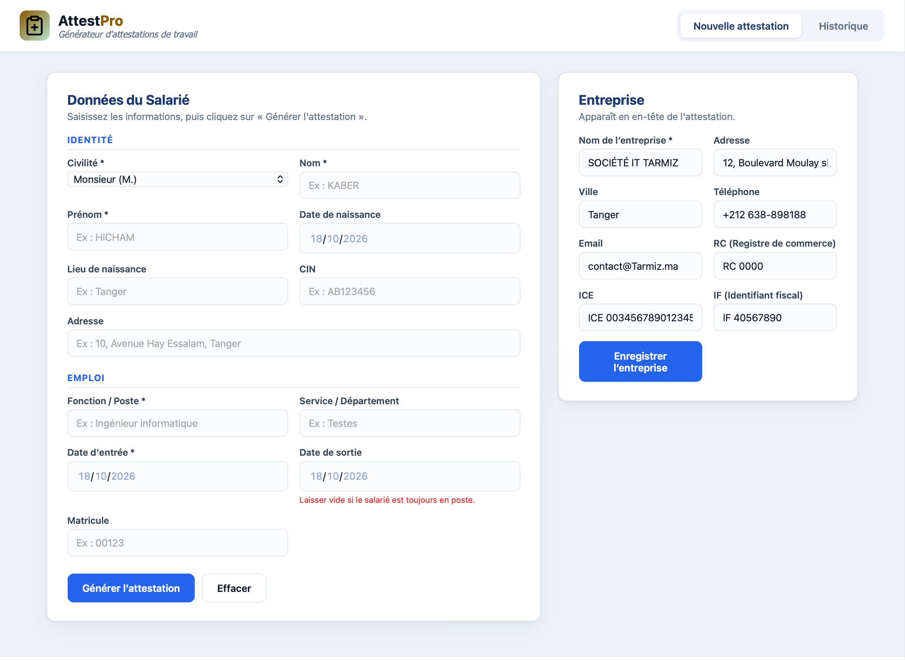

<p align="center">
  
</p>

<h1 align="center">AttestPro</h1>

<p align="center">
  <strong>Work Certificate Generator</strong>
</p>

<p align="center">
  Generate, preview, download, print, and manage professional work certificates in seconds.
</p>

<p align="center">
  <a href="https://www.attestpro.me"><strong>🌐 Visit AttestPro</strong></a>
</p>

---

## Overview

AttestPro is a web application built with React that simplifies the creation and management of employment certificates in PDF format.

Enter an employee’s personal and professional information to generate a professional work certificate that can be previewed, downloaded, and printed directly from the application.

## Application Preview

<p align="center">
  
</p>

## Features

- **PDF Preview** — View generated work certificates directly within the application.
* **PDF Download** — Download certificates as PDF files.
* **Print Support** — Print certificates directly from the application.
* **Certificate History** — View previously generated certificates, download them again, or delete them.
* **Automatic Numbering** — Assign unique certificate numbers, such as AT-2026-0001.
* **Company Settings** — Customize company information, including its name, address, Commercial Register (RC), Tax Identification Number (IF), and ICE.
* **Flexible Data Storage** — Support for local browser storage and Supabase integration.

## Tech Stack

- **Frontend:** React, JavaScript, HTML, CSS
- **Build Tool:** Vite
- **Database:** Supabase (PostgreSQL)
- **PDF Generation:** jsPDF, generated in the browser
- **Deployment:** Vercel


## Getting Started

### Prerequisites

Make sure you have installed:

- Node.js
- npm

### Installation


1. Clone the repository:

   ```bash
   git clone https://github.com/Hichaminventor10/Attestation_generator.git
   ```

2. Navigate to the project directory:

   ```bash
   cd Attestation_generator
   ```

3. Install dependencies:

   ```bash
   npm install
   ```

4. (Optional) Configure Supabase by copying the example environment file:

   ```bash
   cp .env.example .env.local
   ```

   Add your Supabase project URL and **public anon key** to `.env.local`:

   ```env
   VITE_SUPABASE_URL=💁🏼
   VITE_SUPABASE_ANON_KEY=💁🏼
   ```

   The URL and anon key must belong to the same Supabase project. If Supabase is not configured, the application uses its local demo adapter.

5. Start the development server:

   ```bash
   npm run dev
   ```

6. Open the local URL displayed in your terminal.

 ## Live Demo

Try AttestPro online:

[https://www.attestpro.me](https://www.attestpro.me)

## Author

**Hicham Kaber**

- GitHub: [@Hichaminventor10](https://github.com/Hichaminventor10)

---

<p align="center">
  Built with React and a passion for software development.
</p>
